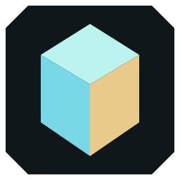
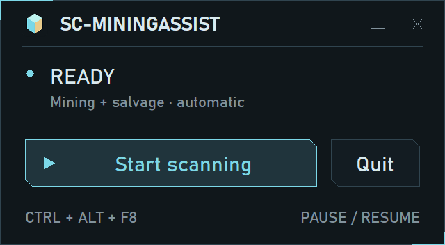

<p align="center"></p>

# SC-MiningAssist

**Read the signature. See the resource. Keep flying.**

A small, local **Star Citizen mining and salvage overlay for Windows**, written in Rust. SC-MiningAssist reads the RS number on screen and shows the matching resource and estimated rock count, or the number of salvage panels.

<p align="center"></p>

- Automatic detection, with room for head movement. No region selection or options to configure.
- A single click-through line at the top of the screen, **28 px tall** at 100% scaling.
- **LOW / MEDIUM / HIGH** mineral difficulty hints, shown with color.
- Native Windows OCR and Win32 UI. No Tesseract, embedded browser, cloud service or downloaded AI model.
- Captures only while scanning with Star Citizen in the foreground. No game-memory access or file modifications.

## Get started

Requires **Windows 10/11 x64** with an English or French Windows OCR language installed. The app is entirely in English.

1. Download the portable **SC-MiningAssist-v0.1.0-win64.zip** from [GitHub Releases](https://github.com/maxbook/SC-MiningAssist/releases/tag/v0.1.0). Extract the archive; do not run it from inside the ZIP.
2. Open **SC-MiningAssist.exe** and click **Start scanning**.
3. Return to Star Citizen in **borderless windowed mode** and display an RS signature in scan mode.

<p align="center"></p>

**Ctrl + Alt + F8** pauses or resumes detection. Double-click the tray icon to reopen the window, or right-click it for controls. **Quit**, the close button, Alt+F4 and taskbar Close all exit the app. Launching it a second time reopens the existing window.

No installer or administrator privileges are needed. SC-MiningAssist starts paused and does not add itself to Windows startup. The first preview is unsigned.

## What the result means

| Signature | Example output | Interpretation |
| --- | --- | --- |
| `10800` | `BEXALITE · 3 ROCKS · HIGH` | 3 × base RS 3600 |
| `8000` | `SALVAGE · 4 PANELS` | 4 × base RS 2000 |
| `18000` | Bexalite ×5 / Salvage ×9 · ? | Multiple valid matches; no unique identification |

These are **estimates from a community signature table**, assuming a homogeneous cluster. They do not reveal exact composition, percentages or RMC quantity. Difficulty describes the mineral's relative resistance/instability; it does **not** determine whether a Prospector, Golem or MOLE can fracture that rock.

Two matching reads confirm a signature. Brief OCR misses are tolerated for five seconds; a different readable value or a recognized distance at the tracked position clears the previous result. The overlay hides when paused or outside the game.

Small, blurred, obscured or distorted HUD text can be missed or misread. Salvage currently has synthetic-image coverage and still needs in-game validation. The community catalog targets **4.7+** and is not a guarantee for every game patch. [Detection details, sources and limitations](docs/DETAILS.md).

## Lightweight and local

The release executable is under 1 MB. It uses GDI pixel capture and **Windows.Media.Ocr** on a worker thread. Images stay in memory during normal use; there is no telemetry or upload. Windows system libraries provide the runtime.

Tracking runs at up to **8 reads/second**, with broad visual acquisition up to **4/second** and expensive fallback OCR limited to once per second. These are scheduling limits, not latency guarantees. [Offline measurements and diagnostics](docs/DETAILS.md#lightweight-operation).

## Build and contribute

Install [Rust with rustup](https://www.rust-lang.org/tools/install), Visual Studio **Desktop development with C++**, and a Windows SDK. The repository pins Rust 1.100.0 and includes Cargo.lock.

```powershell
.\build.ps1             # portable executable in dist/
.\build.ps1 -Test       # unit tests
.\build.ps1 -Lint       # Clippy
.\build.ps1 -Format     # formatting check
.\scripts\package.ps1  # release ZIP and SHA-256 checksum
```

[Contributing and local checks](CONTRIBUTING.md) · [Release guide](docs/PUBLISHING.md) · [Changelog](CHANGELOG.md)

## License and credits

SC-MiningAssist code and original icon artwork are available under the [MIT license](LICENSE). Dependency licenses are included in [THIRD_PARTY_NOTICES.txt](THIRD_PARTY_NOTICES.txt).

Signature references: [STARVEIN](https://starvein.app/en/signatures), [SC Signature Scanner salvage data](https://github.com/Diftic/SC_Signature_Scanner/blob/master/SignatureValue.md#salvage). Mineral ratings: [SCMINER](https://scminer.rocks/data/mineral-directory). Attribution is also kept with the data.

Independent community project. Not affiliated with or endorsed by Cloud Imperium Games. Star Citizen and associated marks belong to their respective owners.
